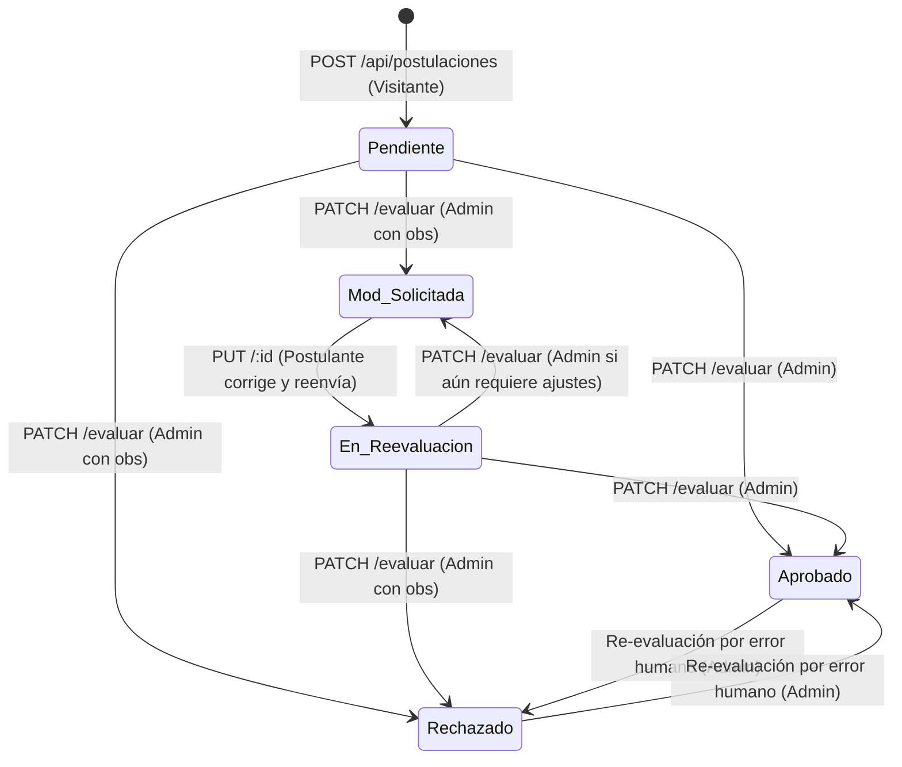

# Design

## Context

El sistema Poncho Digital gestiona el registro y participación de artesanos en la feria. Para postularse, un usuario con rol de `Visitante` (`id_rol = 3`) envía sus antecedentes a través del campo `trayectoria`. Dicha solicitud (`Inscripcion`) atraviesa un ciclo de vida con estados predefinidos en la tabla `Estado`: `Aprobado` (1), `Rechazado` (2), `Pendiente` (3), `Mod_Solicitada` (4) y `En_Reevaluacion` (5).

Para garantizar la coherencia y robustez de la API sin acoplar reglas en exceso en los controladores, la lógica se distribuye entre **middlewares propios del dominio**, una **capa de servicios** con transacciones Prisma y un **manejador centralizado de errores**.

## Goals / Non-Goals

**Goals:**
- Implementar los 6 endpoints del recurso `/api/postulaciones` con persistencia en Prisma Client (`prisma.inscripcion`, `prisma.usuario`).
- Crear una suite de middlewares de dominio modulares en `src/middlewares/postulaciones.middlewares.js` para desacoplar validaciones sintácticas y de negocio.
- Aplicar una máquina de estados estricta que incorpore `En_Reevaluacion` para trazabilidad de correcciones.
- Actualizar de forma atómica el rol del usuario postulante a `Artesano` (`id_rol = 2`) cuando una postulación sea aprobada.
- Exigir `observaciones` obligatorias en decisiones de rechazo y solicitud de modificaciones.

**Non-Goals:**
- Asignación de stands para el artesano (postergado para un flujo independiente posterior).
- Integración de tokens de autenticación JWT (los identificadores de actores `id_artesano` e `id_administrador` se reciben explícitamente en el cuerpo y se validan contra la base de datos).

## Architecture & Middleware Distribution

```
                                          ┌───► [validarCrearPostulacion] ───► [verificarPostulante] ───► crear
                                          │
                                          ├───► [validarIdParam] ──────────────────────────────────────► obtenerPorId
                                          │
/api/postulaciones ─── (Router Express) ─┼───► [validarIdParam] ───► [validarActualizarPostulacion] ───► [verificarEstadoModificable] ───► actualizar
                                          │
                                          ├───► [validarIdParam] ───► [verificarEvaluador] ───► [validarEvaluacion] ───────────────────► evaluar
                                          │
                                          └───► [validarIdParam] ───► [verificarEstadoCancelable] ────────────────────────────────────► eliminar
```

### Middlewares de Dominio

1. **`validarIdParam`**: Comprueba que el parámetro `:id` sea un entero positivo.
2. **`validarCrearPostulacion`**: Comprueba la presencia y formato de `id_artesano` y `trayectoria` (string no vacío).
3. **`verificarPostulante`**:
   - Consulta si el usuario existe.
   - Valida que posea rol de Visitante (`id_rol === 3`).
   - Valida que no tenga una postulación activa en estados 3 (Pendiente), 4 (Mod_Solicitada) o 5 (En_Reevaluacion).
4. **`validarActualizarPostulacion`**: Comprueba que `trayectoria` sea un texto válido y no vacío.
5. **`verificarEstadoModificable`**: Comprueba que la postulación exista y su estado actual sea `3` (Pendiente) o `4` (Mod_Solicitada). Bloquea edición si está en 1, 2 o 5.
6. **`verificarEvaluador`**: Comprueba que `id_administrador` en el body corresponda a un usuario existente con rol Admin (`id_rol === 1`).
7. **`validarEvaluacion`**: Valida que `id_estado` sea 1, 2 o 4, y que si es 2 o 4 incluya obligatoriamente el campo `observaciones`.
8. **`verificarEstadoCancelable`**: Comprueba que la postulación exista y se encuentre en estado `3` (Pendiente).

## State Machine



## Decisions

### 1. Transición Atómica al Aprobar
- **Decisión**: La operación de evaluación a `Aprobado` (`id_estado = 1`) se ejecuta mediante una transacción (`prisma.$transaction`) que actualiza la postulación (`id_estado`, `fecha_evaluacion`, `id_administrador`) y simultáneamente modifica el usuario correspondiente asignándole `id_rol = 2` (Artesano).
- **Razón**: Evita estados inconsistentes donde la postulación figure aprobada pero el usuario permanezca como visitante.

### 2. Introducción del Estado `En_Reevaluacion` (id: 5)
- **Decisión**: Al recibir el `PUT /api/postulaciones/:id` sobre una postulación con `id_estado = 4`, el servicio asigna automáticamente `id_estado = 5`.
- **Razón**: Permite al administrador distinguir qué solicitudes ya fueron atendidas por los postulantes versus aquellas donde el postulante todavía no ha realizado cambios.

### 3. Separación de Validaciones Sintácticas y Semánticas
- **Decisión**: Los middlewares validan primero formato y tipos básicos (`validarCrearPostulacion`), y luego realizan las consultas a base de datos (`verificarPostulante`), abortando rápidamente sin incurrir en I/O innecesario si la carga útil es inválida.

## Risks / Trade-offs

- **[Riesgo] Ausencia de autenticación JWT**: Cualquier cliente podría enviar un `id_administrador` en el cuerpo de la petición.
  - *Mitigación*: El middleware `verificarEvaluador` valida obligatoriamente que dicho ID corresponda a un usuario existente y con rol de Administrador en la base de datos.
- **[Riesgo] Condición de carrera en solicitudes simultáneas**: Dos peticiones simultáneas podrían intentar postular al mismo artesano.
  - *Mitigación*: Se valida la existencia de postulación activa antes de la creación y se manejan posibles excepciones concurrentes.
